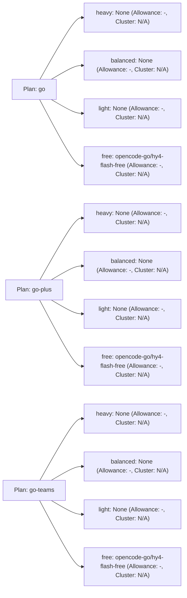
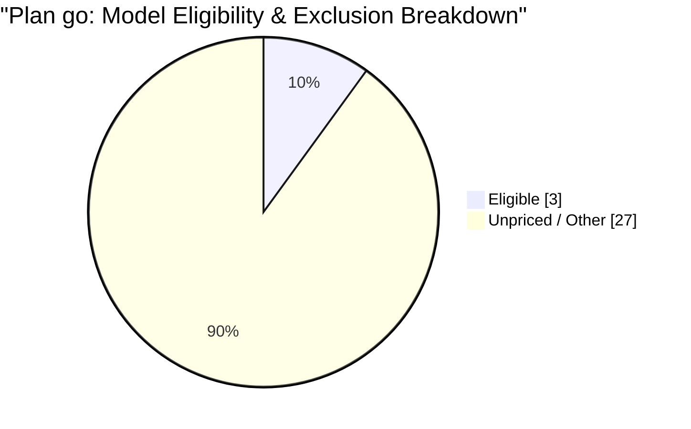
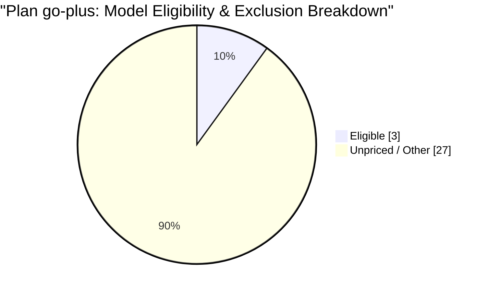
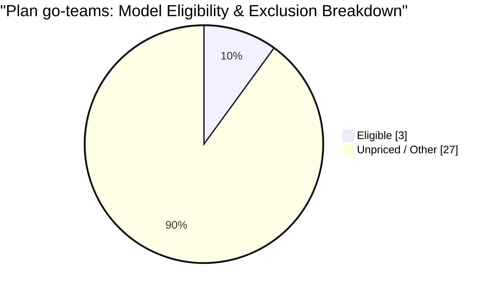
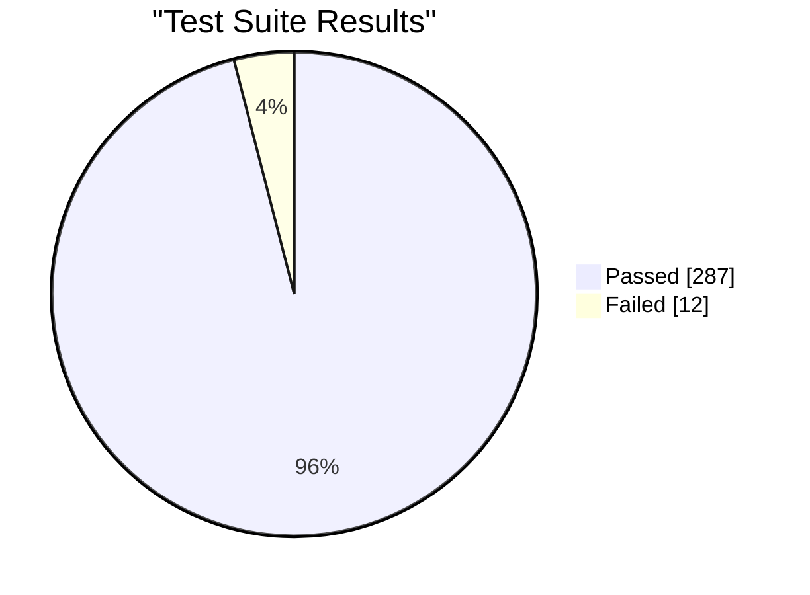

# OpenCode Go model tiers

Generated 2026-11-21T13:29:53+00:00 by opencode-go-model-optimizer 0.1.0 (commit `5a5491de961706b677a33052b9fa8fae61874dbf`). Allowance mode, default criteria, top 3 per tier.

## Run settings

- **Mode**: `allowance` | **Profile**: `general` | **Price basis**: `blended` | **Burn basis**: `auto` | **Top N**: `3`
- **Global regions**: blocked | **Paid training**: blocked | **Free training**: blocked
- **Filters**: max retention `none` | ZDR required `False` | min context `0` | min output `0` | max output cost `none` | max burn `none`

## Plan: go

| Tier | Pick | Allowance | Out $/1M | Price x | Burn %/1k turns | Basis | Fallbacks |
| --- | --- | --- | --- | --- | --- | --- | --- |
| heavy | `-` | - | - | 1 | - | - | - |
| balanced | `-` | - | - | 1 | - | - | - |
| light | `-` | - | - | 1 | - | - | - |
| free | `opencode-go/hy4-flash-free` | None | $0 | 1 | 0.0 | tokens | `opencode-go/longcat-2.5-free`, `opencode-go/iceman-contributor-free` |

Why:

- **heavy**: no eligible model in the heavy cluster
- **balanced**: no eligible model in the balanced cluster
- **light**: no eligible model in the light cluster
- **free**: opencode-go/hy4-flash-free is the newest eligible zero-cost model (then larger context, then id)

Excluded models

| Model | Reason |
| --- | --- |
| `opencode-go/claude-haiku-5-5` | unpriced: no docs pricing row for this plan |
| `opencode-go/deepseek-v4-pro` | unpriced: no docs pricing row for this plan |
| `opencode-go/deepseek-v4.1-flash` | unpriced: no docs pricing row for this plan |
| `opencode-go/gemini-4-argon` | unpriced: no docs pricing row for this plan |
| `opencode-go/glm-5.3` | unpriced: no docs pricing row for this plan |
| `opencode-go/glm-5.3-flash` | unpriced: no docs pricing row for this plan |
| `opencode-go/gpt-5.6-luna` | unpriced: no docs pricing row for this plan |
| `opencode-go/gpt-6-luna` | unpriced: no docs pricing row for this plan |
| `opencode-go/grok-4.7` | unpriced: no docs pricing row for this plan |
| `opencode-go/hy3` | unpriced: no docs pricing row for this plan |
| `opencode-go/hy4` | unpriced: no docs pricing row for this plan |
| `opencode-go/hy4-preview` | unpriced: no docs pricing row for this plan |
| `opencode-go/kimi-k2.7-code` | unpriced: no docs pricing row for this plan |
| `opencode-go/kimi-k3` | unpriced: no docs pricing row for this plan |
| `opencode-go/kimi-k3.1-pro` | unpriced: no docs pricing row for this plan |
| `opencode-go/longcat-2.0` | unpriced: no docs pricing row for this plan |
| `opencode-go/mimo-v2.6-flash` | unpriced: no docs pricing row for this plan |
| `opencode-go/mimo-v2.6-pro` | unpriced: no docs pricing row for this plan |
| `opencode-go/minimax-m3` | unpriced: no docs pricing row for this plan |
| `opencode-go/minimax-m3.1-flash` | unpriced: no docs pricing row for this plan |
| `opencode-go/muse-spark-1.2-contributor` | unpriced: no docs pricing row for this plan |
| `opencode-go/muse-spark-1.3-contributor` | unpriced: no docs pricing row for this plan |
| `opencode-go/qwen3.7-plus` | unpriced: no docs pricing row for this plan |
| `opencode-go/qwen3.8-flash` | unpriced: no docs pricing row for this plan |
| `opencode-go/qwen3.8-max` | unpriced: no docs pricing row for this plan |
| `opencode-go/qwen4-max` | unpriced: no docs pricing row for this plan |
| `opencode-go/step-5-preview` | unpriced: no docs pricing row for this plan |

## Plan: go-plus

| Tier | Pick | Allowance | Out $/1M | Price x | Burn %/1k turns | Basis | Fallbacks |
| --- | --- | --- | --- | --- | --- | --- | --- |
| heavy | `-` | - | - | 1 | - | - | - |
| balanced | `-` | - | - | 1 | - | - | - |
| light | `-` | - | - | 1 | - | - | - |
| free | `opencode-go/hy4-flash-free` | None | $0 | 1 | 0.0 | tokens | `opencode-go/longcat-2.5-free`, `opencode-go/iceman-contributor-free` |

Why:

- **heavy**: no eligible model in the heavy cluster
- **balanced**: no eligible model in the balanced cluster
- **light**: no eligible model in the light cluster
- **free**: opencode-go/hy4-flash-free is the newest eligible zero-cost model (then larger context, then id)

Excluded models

| Model | Reason |
| --- | --- |
| `opencode-go/claude-haiku-5-5` | unpriced: no docs pricing row for this plan |
| `opencode-go/deepseek-v4-pro` | unpriced: no docs pricing row for this plan |
| `opencode-go/deepseek-v4.1-flash` | unpriced: no docs pricing row for this plan |
| `opencode-go/gemini-4-argon` | unpriced: no docs pricing row for this plan |
| `opencode-go/glm-5.3` | unpriced: no docs pricing row for this plan |
| `opencode-go/glm-5.3-flash` | unpriced: no docs pricing row for this plan |
| `opencode-go/gpt-5.6-luna` | unpriced: no docs pricing row for this plan |
| `opencode-go/gpt-6-luna` | unpriced: no docs pricing row for this plan |
| `opencode-go/grok-4.7` | unpriced: no docs pricing row for this plan |
| `opencode-go/hy3` | unpriced: no docs pricing row for this plan |
| `opencode-go/hy4` | unpriced: no docs pricing row for this plan |
| `opencode-go/hy4-preview` | unpriced: no docs pricing row for this plan |
| `opencode-go/kimi-k2.7-code` | unpriced: no docs pricing row for this plan |
| `opencode-go/kimi-k3` | unpriced: no docs pricing row for this plan |
| `opencode-go/kimi-k3.1-pro` | unpriced: no docs pricing row for this plan |
| `opencode-go/longcat-2.0` | unpriced: no docs pricing row for this plan |
| `opencode-go/mimo-v2.6-flash` | unpriced: no docs pricing row for this plan |
| `opencode-go/mimo-v2.6-pro` | unpriced: no docs pricing row for this plan |
| `opencode-go/minimax-m3` | unpriced: no docs pricing row for this plan |
| `opencode-go/minimax-m3.1-flash` | unpriced: no docs pricing row for this plan |
| `opencode-go/muse-spark-1.2-contributor` | unpriced: no docs pricing row for this plan |
| `opencode-go/muse-spark-1.3-contributor` | unpriced: no docs pricing row for this plan |
| `opencode-go/qwen3.7-plus` | unpriced: no docs pricing row for this plan |
| `opencode-go/qwen3.8-flash` | unpriced: no docs pricing row for this plan |
| `opencode-go/qwen3.8-max` | unpriced: no docs pricing row for this plan |
| `opencode-go/qwen4-max` | unpriced: no docs pricing row for this plan |
| `opencode-go/step-5-preview` | unpriced: no docs pricing row for this plan |

## Plan: go-teams

| Tier | Pick | Allowance | Out $/1M | Price x | Burn %/1k turns | Basis | Fallbacks |
| --- | --- | --- | --- | --- | --- | --- | --- |
| heavy | `-` | - | - | 1 | - | - | - |
| balanced | `-` | - | - | 1 | - | - | - |
| light | `-` | - | - | 1 | - | - | - |
| free | `opencode-go/hy4-flash-free` | None | $0 | 1 | 0.0 | tokens | `opencode-go/longcat-2.5-free`, `opencode-go/iceman-contributor-free` |

Why:

- **heavy**: no eligible model in the heavy cluster
- **balanced**: no eligible model in the balanced cluster
- **light**: no eligible model in the light cluster
- **free**: opencode-go/hy4-flash-free is the newest eligible zero-cost model (then larger context, then id)

Excluded models

| Model | Reason |
| --- | --- |
| `opencode-go/claude-haiku-5-5` | unpriced: no docs pricing row for this plan |
| `opencode-go/deepseek-v4-pro` | unpriced: no docs pricing row for this plan |
| `opencode-go/deepseek-v4.1-flash` | unpriced: no docs pricing row for this plan |
| `opencode-go/gemini-4-argon` | unpriced: no docs pricing row for this plan |
| `opencode-go/glm-5.3` | unpriced: no docs pricing row for this plan |
| `opencode-go/glm-5.3-flash` | unpriced: no docs pricing row for this plan |
| `opencode-go/gpt-5.6-luna` | unpriced: no docs pricing row for this plan |
| `opencode-go/gpt-6-luna` | unpriced: no docs pricing row for this plan |
| `opencode-go/grok-4.7` | unpriced: no docs pricing row for this plan |
| `opencode-go/hy3` | unpriced: no docs pricing row for this plan |
| `opencode-go/hy4` | unpriced: no docs pricing row for this plan |
| `opencode-go/hy4-preview` | unpriced: no docs pricing row for this plan |
| `opencode-go/kimi-k2.7-code` | unpriced: no docs pricing row for this plan |
| `opencode-go/kimi-k3` | unpriced: no docs pricing row for this plan |
| `opencode-go/kimi-k3.1-pro` | unpriced: no docs pricing row for this plan |
| `opencode-go/longcat-2.0` | unpriced: no docs pricing row for this plan |
| `opencode-go/mimo-v2.6-flash` | unpriced: no docs pricing row for this plan |
| `opencode-go/mimo-v2.6-pro` | unpriced: no docs pricing row for this plan |
| `opencode-go/minimax-m3` | unpriced: no docs pricing row for this plan |
| `opencode-go/minimax-m3.1-flash` | unpriced: no docs pricing row for this plan |
| `opencode-go/muse-spark-1.2-contributor` | unpriced: no docs pricing row for this plan |
| `opencode-go/muse-spark-1.3-contributor` | unpriced: no docs pricing row for this plan |
| `opencode-go/qwen3.7-plus` | unpriced: no docs pricing row for this plan |
| `opencode-go/qwen3.8-flash` | unpriced: no docs pricing row for this plan |
| `opencode-go/qwen3.8-max` | unpriced: no docs pricing row for this plan |
| `opencode-go/qwen4-max` | unpriced: no docs pricing row for this plan |
| `opencode-go/step-5-preview` | unpriced: no docs pricing row for this plan |

## How this was decided

- Mode: allowance. No benchmark data is used; models are ranked by published plan allowance and price only.
- Eligibility: only active models are considered. Models without a positive finite allowance are excluded from the paid tiers. OpenCode Go privacy defaults apply: Global-region models are blocked, paid endpoints that train on request data are blocked, and free endpoints that train are blocked. Preview models are included. Retention is unrestricted unless a retention/ZDR flag is set.
- Price: catalogue token prices are scaled by each model's price multiplier (peak hours, promo expiry) using the 7-day time-weighted average starting at generation time.
- Tiers: eligible paid models are split into three clusters by log effective output price (natural breaks): the dearest cluster is heavy, the middle balanced, the cheapest light.
- Ranking inside a cluster: highest monthly allowance first, then lowest effective output price, then newest release date, then largest context window, then model id.
- Free tier: zero-cost (or contributor/unlimited) models, newest release first, then largest context window, then model id.
- Quota burn: percent of the monthly allowance consumed per 1,000 turns, from the docs request estimates when published (scaled by the price multiplier), otherwise from a synthetic token mix. Shown for context; it is not a ranking key in allowance mode.
- Fallbacks: the next 2 candidates per tier, drawn from the same cluster and then from the general paid ranking.

## Warnings

- no rows parsed from the go-pricing table in the docs; the docs format may have changed and no pricing was applied
- no rows parsed from the docs Privacy table; privacy/region filters have no data
- no rows parsed from the docs go-requests table; quota burn uses synthetic token costs
- [go] no model available for tier heavy
- [go] no model available for tier balanced
- [go] no model available for tier light
- [go-plus] no model available for tier heavy
- [go-plus] no model available for tier balanced
- [go-plus] no model available for tier light
- [go-teams] no model available for tier heavy
- [go-teams] no model available for tier balanced
- [go-teams] no model available for tier light

## Provenance

| Source | URL | HTTP | Fetched | sha256 | Bytes |
| --- | --- | --- | --- | --- | --- |
| docs | https://raw.githubusercontent.com/anomalyco/opencode/dev/services/site/src/docs/content/console/go.mdx | 200 | 2026-11-21T13:29:53+00:00 | `757ab6271160ddea...` | 17636 |
| catalogue | https://opencode.ai/inference/go/v1/models | 200 | 2026-11-21T13:29:53+00:00 | `553f89a9b3becf87...` | 42361 |
| models_dev | https://models.dev/api.json | 200 | 2026-11-21T13:29:54+00:00 | `c9c52b676045a745...` | 6789127 |

sha256 and byte length of each raw response body; bodies are not published. Full digests are in results.json.

## Test results

Overall: **fail**

| Run | Passed | Failed | Skipped |
| --- | --- | --- | --- |
| offline | 285 | 0 | 0 |
| live | 2 | 12 | 0 |

Failing tests: `tests.live.test_contract::test_pricing_table_parses_rows[go]`, `tests.live.test_contract::test_pricing_table_parses_rows[go-plus]`, `tests.live.test_contract::test_pricing_table_parses_rows[go-teams]`, `tests.live.test_contract::test_request_estimates_parse_rows[go]`, `tests.live.test_contract::test_request_estimates_parse_rows[go-plus]`, `tests.live.test_contract::test_request_estimates_parse_rows[go-teams]`, `tests.live.test_contract::test_endpoints_table_is_non_empty`, `tests.live.test_contract::test_privacy_table_is_non_empty`, `tests.live.test_contract::test_active_models_get_pricing_privacy_and_estimates`, `tests.live.test_contract::test_select_yields_paid_tiers[go]`, `tests.live.test_contract::test_select_yields_paid_tiers[go-plus]`, `tests.live.test_contract::test_select_yields_paid_tiers[go-teams]`
