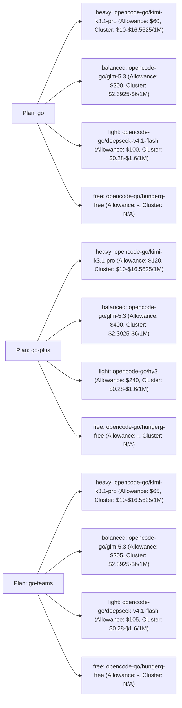
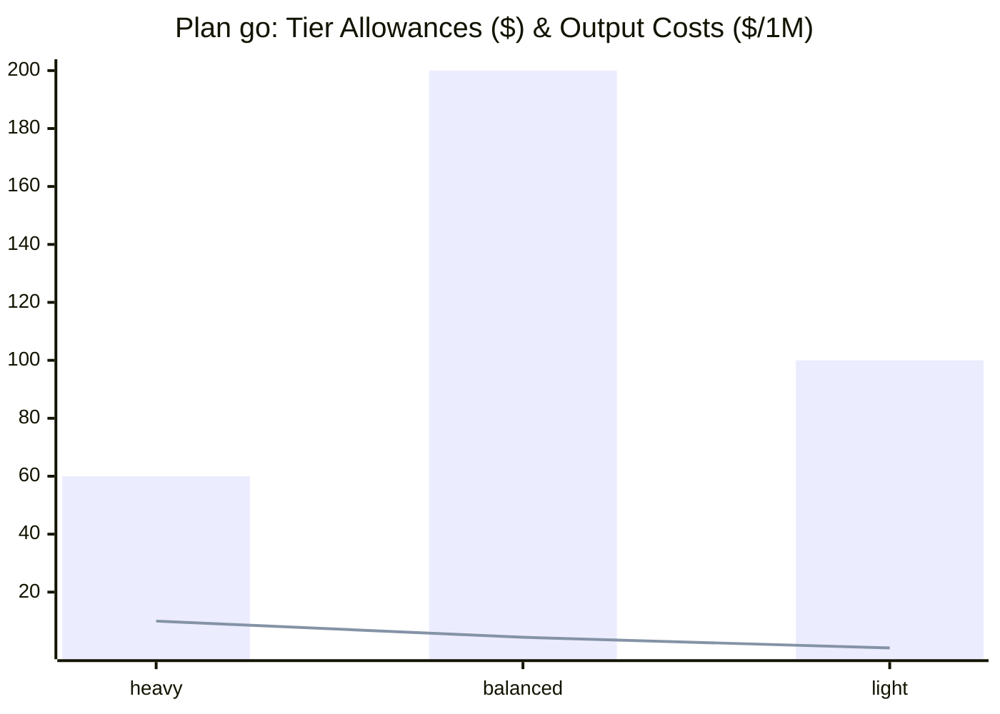
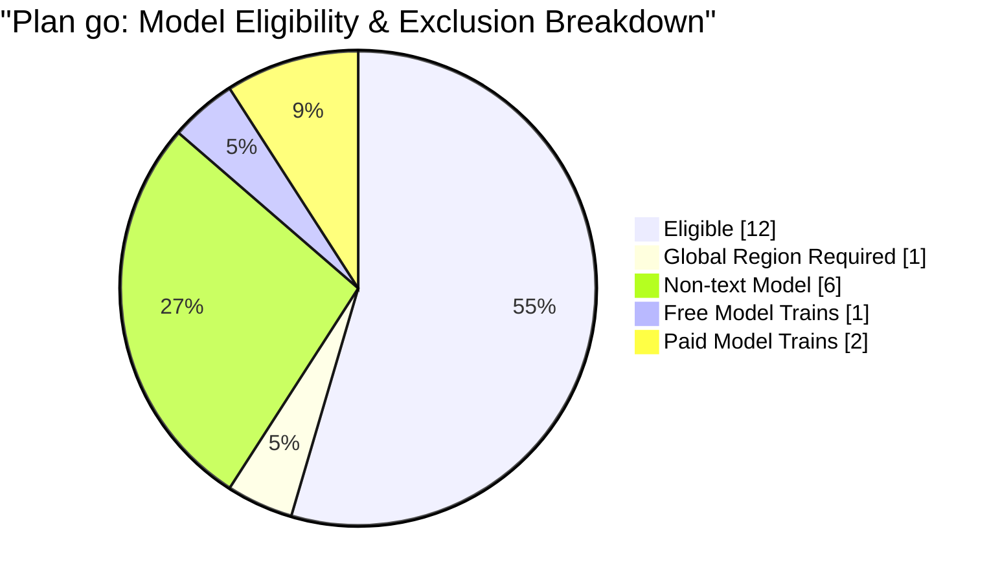
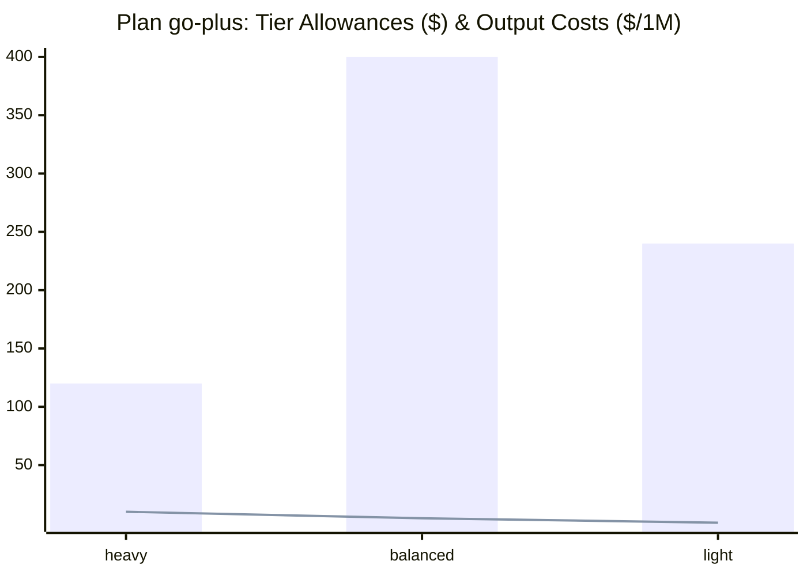
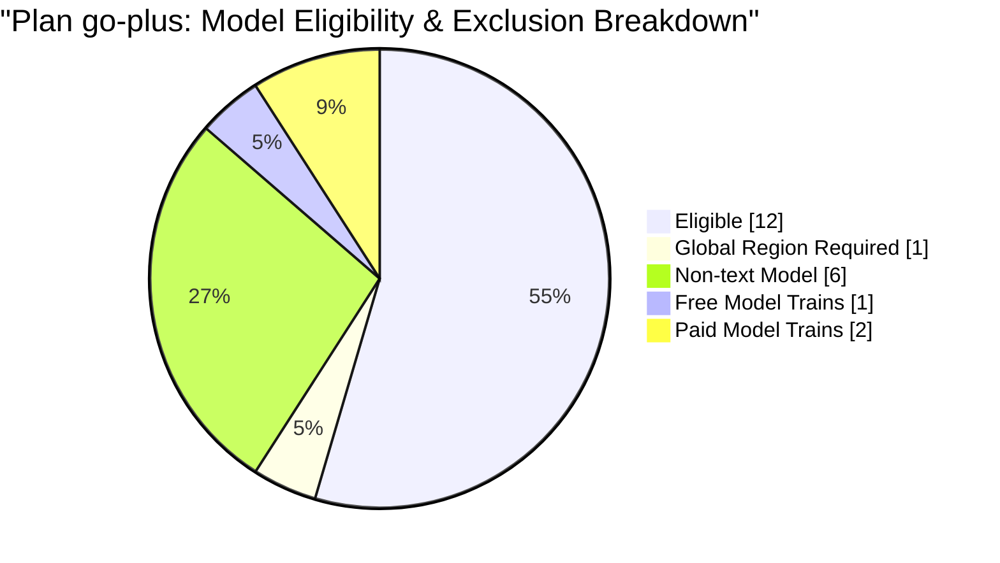
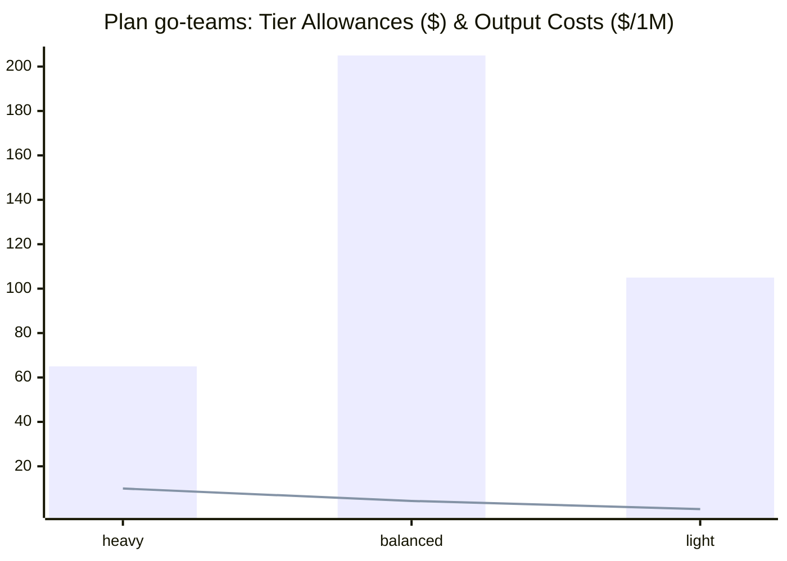
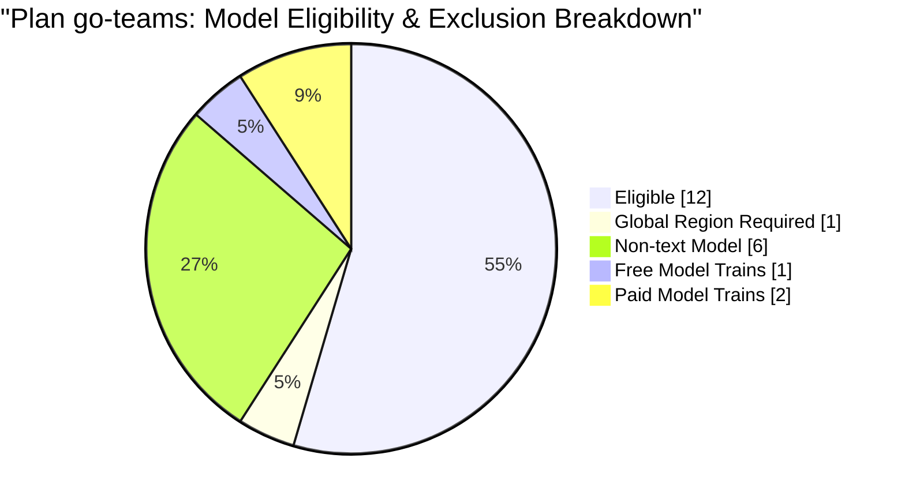
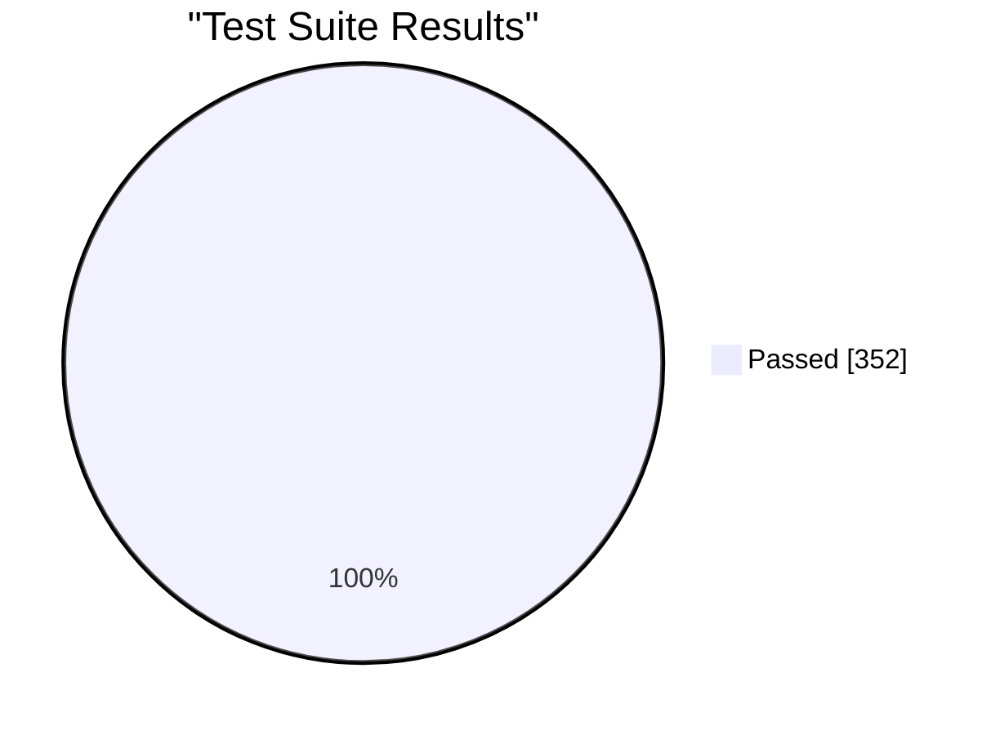

# OpenCode Go model tiers

Generated 2026-11-28T14:15:01+00:00 by opencode-go-model-optimizer 0.1.0 (commit `15d3ca05e9e9a80bdf426de3011d90d0a1a8fecc`). Allowance mode, default criteria, top 3 per tier.

## Run settings

- **Mode**: `allowance` | **Fallback**: disabled | **Profile**: `general` | **Price basis**: `blended` | **Burn basis**: `auto` | **Top N**: `3`
- **Global regions**: blocked | **Paid training**: blocked | **Free training**: blocked
- **Filters**: max retention `none` | ZDR required `False` | min context `0` | min output `0` | max output cost `none` | max burn `none`

## Plan: go

| Tier | Pick | Allowance | Out $/1M | Price x | Burn %/1k turns | Basis | Fallbacks |
| --- | --- | --- | --- | --- | --- | --- | --- |
| heavy | `opencode-go/kimi-k3.1-pro` | 60.0 | $10 | 1 | 34.01 | estimate | `opencode-go/gemini-4-argon`, `opencode-go/kimi-k3` |
| balanced | `opencode-go/glm-5.3` | 200.0 | $4.4 | 1 | 7.58 | estimate | `opencode-go/hy4`, `opencode-go/kimi-k2.7-code` |
| light | `opencode-go/deepseek-v4.1-flash` | 100.0 | $0.725 | 1.2083 | 0.56 | estimate | `opencode-go/mimo-v2.6-flash`, `opencode-go/glm-5.3-flash` |
| free | `opencode-go/hungerg-free` | - | $0 | 1 | 0.0 | estimate | `opencode-go/hy4-flash-free`, `opencode-go/beam-free` |

Why:

- **heavy**: opencode-go/kimi-k3.1-pro has the highest allowance among eligible models in the heavy price cluster, with ties broken by lower output price, newer release, larger context
  - cluster of 3 model(s), effective output $10-$16.5625/1M
  - privacy: trains_on_data=False, retention_days=0, zdr=True, global_region_required=False
- **balanced**: opencode-go/glm-5.3 has the highest allowance among eligible models in the balanced price cluster, with ties broken by lower output price, newer release, larger context
  - cluster of 9 model(s), effective output $2.3925-$6/1M
  - privacy: trains_on_data=False, retention_days=0, zdr=True, global_region_required=False
- **light**: opencode-go/deepseek-v4.1-flash has the highest allowance among eligible models in the light price cluster, with ties broken by lower output price, newer release, larger context
  - cluster of 12 model(s), effective output $0.28-$1.6/1M
  - privacy: trains_on_data=False, retention_days=0, zdr=True, global_region_required=False
- **free**: opencode-go/hungerg-free is the newest eligible zero-cost model (then larger context, then id)
  - privacy: trains_on_data=False, retention_days=None, zdr=True, global_region_required=False

Excluded models

| Model | Reason |
| --- | --- |
| `opencode-go/gemini-decision-1` | not a text model (type 'decision') |
| `opencode-go/gemini-embedding-2` | not a text model (type 'embedding') |
| `opencode-go/gpt-6-luna-decision` | not a text model (type 'decision') |
| `opencode-go/iceman-contributor-free` | free model trains on request data (enable --allow-free-training) |
| `opencode-go/jev-1.14` | not a text model (type 'decision') |
| `opencode-go/longcat-2.5` | requires Global workspace region (enable --allow-global-region) |
| `opencode-go/muse-spark-1.2-contributor` | paid model trains on request data (enable --allow-paid-training) |
| `opencode-go/muse-spark-1.3-contributor` | paid model trains on request data (enable --allow-paid-training) |
| `opencode-go/qwen3-embedding-8b` | not a text model (type 'embedding') |
| `opencode-go/text-embedding-3-small` | not a text model (type 'embedding') |

## Plan: go-plus

| Tier | Pick | Allowance | Out $/1M | Price x | Burn %/1k turns | Basis | Fallbacks |
| --- | --- | --- | --- | --- | --- | --- | --- |
| heavy | `opencode-go/kimi-k3.1-pro` | 120.0 | $10 | 1 | 17.01 | estimate | `opencode-go/gemini-4-argon`, `opencode-go/kimi-k3` |
| balanced | `opencode-go/glm-5.3` | 400.0 | $4.4 | 1 | 3.79 | estimate | `opencode-go/hy4`, `opencode-go/kimi-k2.7-code` |
| light | `opencode-go/hy3` | 240.0 | $0.58 | 1 | 1.16 | estimate | `opencode-go/deepseek-v4.1-flash`, `opencode-go/glm-5.3-flash` |
| free | `opencode-go/hungerg-free` | - | $0 | 1 | 0.0 | estimate | `opencode-go/hy4-flash-free`, `opencode-go/beam-free` |

Why:

- **heavy**: opencode-go/kimi-k3.1-pro has the highest allowance among eligible models in the heavy price cluster, with ties broken by lower output price, newer release, larger context
  - cluster of 3 model(s), effective output $10-$16.5625/1M
  - privacy: trains_on_data=False, retention_days=0, zdr=True, global_region_required=False
- **balanced**: opencode-go/glm-5.3 has the highest allowance among eligible models in the balanced price cluster, with ties broken by lower output price, newer release, larger context
  - cluster of 9 model(s), effective output $2.3925-$6/1M
  - privacy: trains_on_data=False, retention_days=0, zdr=True, global_region_required=False
- **light**: opencode-go/hy3 has the highest allowance among eligible models in the light price cluster, with ties broken by lower output price, newer release, larger context
  - cluster of 12 model(s), effective output $0.28-$1.6/1M
  - privacy: trains_on_data=False, retention_days=0, zdr=True, global_region_required=False
- **free**: opencode-go/hungerg-free is the newest eligible zero-cost model (then larger context, then id)
  - privacy: trains_on_data=False, retention_days=None, zdr=True, global_region_required=False

Excluded models

| Model | Reason |
| --- | --- |
| `opencode-go/gemini-decision-1` | not a text model (type 'decision') |
| `opencode-go/gemini-embedding-2` | not a text model (type 'embedding') |
| `opencode-go/gpt-6-luna-decision` | not a text model (type 'decision') |
| `opencode-go/iceman-contributor-free` | free model trains on request data (enable --allow-free-training) |
| `opencode-go/jev-1.14` | not a text model (type 'decision') |
| `opencode-go/longcat-2.5` | requires Global workspace region (enable --allow-global-region) |
| `opencode-go/muse-spark-1.2-contributor` | paid model trains on request data (enable --allow-paid-training) |
| `opencode-go/muse-spark-1.3-contributor` | paid model trains on request data (enable --allow-paid-training) |
| `opencode-go/qwen3-embedding-8b` | not a text model (type 'embedding') |
| `opencode-go/text-embedding-3-small` | not a text model (type 'embedding') |

## Plan: go-teams

| Tier | Pick | Allowance | Out $/1M | Price x | Burn %/1k turns | Basis | Fallbacks |
| --- | --- | --- | --- | --- | --- | --- | --- |
| heavy | `opencode-go/kimi-k3.1-pro` | 65.0 | $10 | 1 | 31.35 | estimate | `opencode-go/gemini-4-argon`, `opencode-go/kimi-k3` |
| balanced | `opencode-go/glm-5.3` | 205.0 | $4.4 | 1 | 7.41 | estimate | `opencode-go/hy4`, `opencode-go/kimi-k2.7-code` |
| light | `opencode-go/deepseek-v4.1-flash` | 105.0 | $0.725 | 1.2083 | 0.53 | estimate | `opencode-go/mimo-v2.6-flash`, `opencode-go/glm-5.3-flash` |
| free | `opencode-go/hungerg-free` | - | $0 | 1 | 0.0 | estimate | `opencode-go/hy4-flash-free`, `opencode-go/beam-free` |

Why:

- **heavy**: opencode-go/kimi-k3.1-pro has the highest allowance among eligible models in the heavy price cluster, with ties broken by lower output price, newer release, larger context
  - cluster of 3 model(s), effective output $10-$16.5625/1M
  - privacy: trains_on_data=False, retention_days=0, zdr=True, global_region_required=False
- **balanced**: opencode-go/glm-5.3 has the highest allowance among eligible models in the balanced price cluster, with ties broken by lower output price, newer release, larger context
  - cluster of 9 model(s), effective output $2.3925-$6/1M
  - privacy: trains_on_data=False, retention_days=0, zdr=True, global_region_required=False
- **light**: opencode-go/deepseek-v4.1-flash has the highest allowance among eligible models in the light price cluster, with ties broken by lower output price, newer release, larger context
  - cluster of 12 model(s), effective output $0.28-$1.6/1M
  - privacy: trains_on_data=False, retention_days=0, zdr=True, global_region_required=False
- **free**: opencode-go/hungerg-free is the newest eligible zero-cost model (then larger context, then id)
  - privacy: trains_on_data=False, retention_days=None, zdr=True, global_region_required=False

Excluded models

| Model | Reason |
| --- | --- |
| `opencode-go/gemini-decision-1` | not a text model (type 'decision') |
| `opencode-go/gemini-embedding-2` | not a text model (type 'embedding') |
| `opencode-go/gpt-6-luna-decision` | not a text model (type 'decision') |
| `opencode-go/iceman-contributor-free` | free model trains on request data (enable --allow-free-training) |
| `opencode-go/jev-1.14` | not a text model (type 'decision') |
| `opencode-go/longcat-2.5` | requires Global workspace region (enable --allow-global-region) |
| `opencode-go/muse-spark-1.2-contributor` | paid model trains on request data (enable --allow-paid-training) |
| `opencode-go/muse-spark-1.3-contributor` | paid model trains on request data (enable --allow-paid-training) |
| `opencode-go/qwen3-embedding-8b` | not a text model (type 'embedding') |
| `opencode-go/text-embedding-3-small` | not a text model (type 'embedding') |

## How this was decided

- Mode: allowance. No benchmark data is used; models are ranked by published plan allowance and price only.
- Sources: per-plan allowance and the training/ZDR flags come from the Go models API (`go.monthly_usage`, `go.training`, `go.zdr`); token prices come from the same catalogue. The docs Privacy table supplies retention days and agreement notes, and explicit docs text supplies the workspace Global-region requirement. `go.limited_regions` is recorded as advisory only, because regional availability is not the same as the Global setting.
- Eligibility: only active text (chat) models are considered. Models without a positive finite allowance are excluded from the paid tiers. OpenCode Go privacy defaults apply: Global-region models are blocked, paid endpoints that train on request data are blocked, and free endpoints that train are blocked. Preview models are included. Retention is unrestricted unless a retention/ZDR flag is set. A model that publishes a monthly allowance but no token prices is treated as incomplete catalogue data and excluded from every tier.
- Price: catalogue token prices are scaled by each model's price multiplier (peak hours, promo expiry) using the 7-day time-weighted average starting at generation time.
- Tiers: eligible paid models are split into three clusters by log effective output price (natural breaks): the dearest cluster is heavy, the middle balanced, the cheapest light.
- Ranking inside a cluster: highest monthly allowance first, then lowest effective output price, then newest release date, then largest context window, then model id.
- Free tier: zero-cost (or contributor/unlimited) models, newest release first, then largest context window, then model id.
- Quota burn: percent of the monthly allowance consumed per 1,000 turns, using the console's per-model token profile to estimate requests per month (scaled by the price multiplier). Shown for context; it is not a ranking key in allowance mode.
- Fallbacks: the next 2 candidates per tier, drawn from the same cluster and then from the general paid ranking.

## Warnings

None.

## Provenance

| Source | URL | HTTP | Fetched | sha256 | Bytes |
| --- | --- | --- | --- | --- | --- |
| docs | https://raw.githubusercontent.com/anomalyco/opencode/dev/services/site/src/docs/content/console/go.mdx | 200 | 2026-11-28T14:15:01+00:00 | `f5631af8531fcb26...` | 22802 |
| console | https://opencode.ai/console/go | 200 | 2026-11-28T14:15:01+00:00 | `86908eac0b585465...` | 159013 |
| catalogue | https://opencode.ai/inference/go/v1/models | 200 | 2026-11-28T14:15:01+00:00 | `16910131cc8ae215...` | 49432 |
| models_dev | https://models.dev/api.json | 200 | 2026-11-28T14:15:01+00:00 | `85cbedfbf1813fb1...` | 6857422 |

sha256 and byte length of each raw response body; bodies are not published. Full digests are in results.json.

## Test results

Overall: **pass**

| Run | Passed | Failed | Skipped |
| --- | --- | --- | --- |
| offline | 339 | 0 | 0 |
| live | 13 | 0 | 0 |
