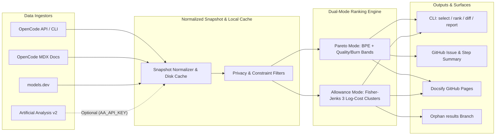
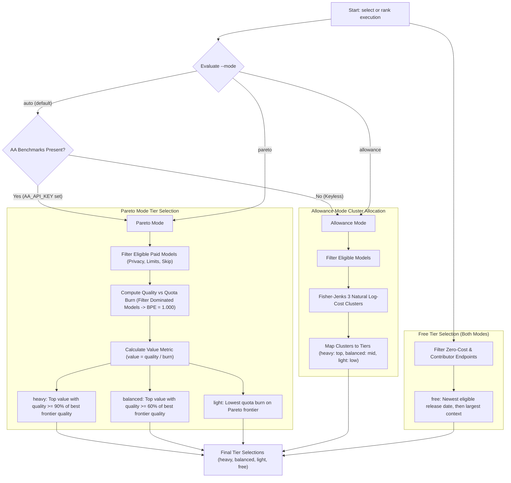
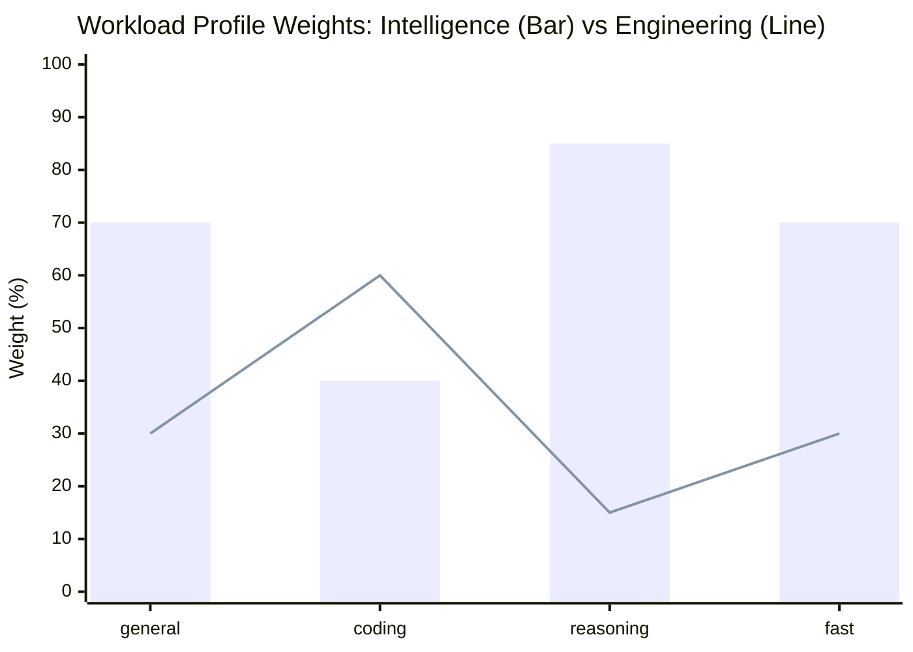
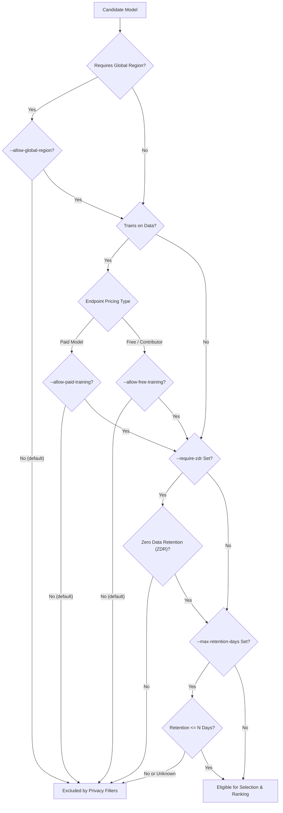
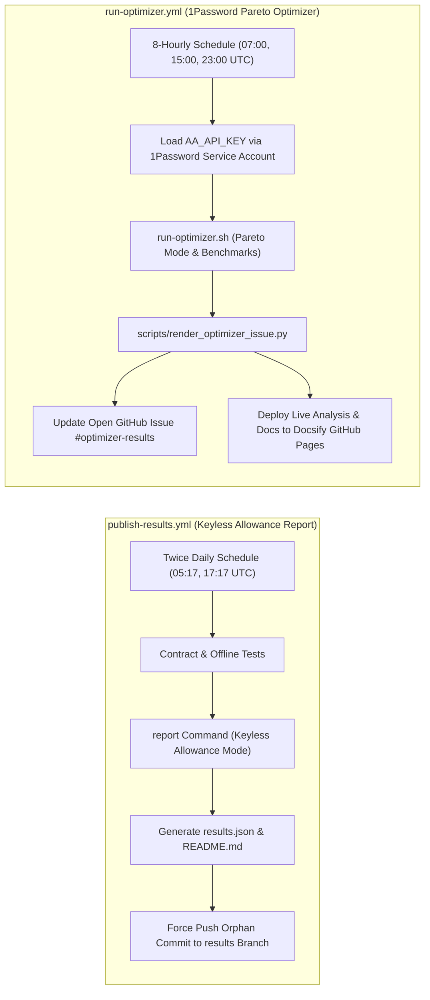

# OpenCode Go Model Optimizer (`opencode-go-model-optimizer`)

Dynamic model tiering and Pareto efficiency optimizer for OpenCode Go ($10/mo subscription).

Evaluates the active OpenCode Go model catalog and computes optimal model assignments across industry-standard capability tiers based on live pricing regimes, monthly allowances, and benchmark intelligence metrics.

---

## Overview & Architecture

`opencode-go-model-optimizer` provides a clean, decoupled engine that evaluates the OpenCode Go catalog without being bound to any specific consumer framework or agent runner.



```text
┌────────────────────────────────────────────────────────────────────────┐
│                      opencode-go-model-optimizer                       │
│                                                                        │
│  ┌──────────────────────┐               ┌───────────────────────────┐  │
│  │    Data Ingestors    │               │      Ranking Engine       │  │
│  │ - OpenCode API / CLI │               │ - Dual-Mode Selector:     │  │
│  │ - OpenCode MDX Docs  ├──────────────►│   • Pareto + AA Benchmark │  │
│  │ - models.dev         │               │   • Allowance Heuristic   │  │
│  │ - ArtificialAnalysis │               │ - Natural Fisher-Jenks    │  │
│  └──────────────────────┘               └─────────────┬─────────────┘  │
│                                                       │                │
│                                                       ▼                │
│                                         ┌───────────────────────────┐  │
│                                         │      Standard Outputs     │  │
│                                         │ - Structured JSON Schema  │  │
│                                         │ - Markdown / ASCII Table  │  │
│                                         │ - Raw Ingested Snapshot   │  │
│                                         └───────────────────────────┘  │
└────────────────────────────────────────────────────────────────────────┘
```

### Industry-Standard Model Tiers

Rather than proprietary or vendor-specific labels, models are classified into standard capability tiers:

- **`heavy`**: High-compute, complex tasks and deep reasoning.
- **`balanced`**: High-capability, cost-effective daily workhorse.
- **`light`**: High-throughput, low-latency, lightweight models.
- **`free`**: Active zero-cost models (promos, contributor tiers, or unmetered).

Consumers (such as agent orchestrators, developer tools, CI workflows, or configuration managers) map these standard tiers to their own internal configs.

### Operating Modes

- **Pareto Mode (`--mode pareto`):** Evaluates Artificial Analysis benchmarks (Intelligence & Engineering capability indices) against monthly quota burn using Bidirectional Pareto Efficiency (BPE). Only Pareto-optimal models are eligible: `heavy` is the value winner among frontier models within 10% of the best quality, `balanced` the value winner among models at least 60% as capable as the best, and `light` the lowest-burn frontier model. Tiers may share a model rather than falling back to a dominated one.
- **Allowance Mode (`--mode allowance`):** Zero-API-key heuristic ranking models by published monthly plan allowance, output token costs, and release recency.
- **Auto (`--mode auto`, the default):** Uses Pareto when benchmark data is present, otherwise allowance. Without `AA_API_KEY` no benchmarks exist, so `auto` always resolves to allowance mode.



#### How Pareto tiers are chosen

1. **Eligibility.** Start from active, non-free models that pass the privacy/region, context, output, output-cost and quota-burn filters and are not skipped with `--skip`. OpenCode Go privacy defaults apply: Global-region models, paid endpoints that train, and free endpoints that train are all blocked unless the corresponding `--allow-*` flag is passed. Pareto paid tiers only consider models that have an AA benchmark; unbenchmarked models are left to allowance mode.
2. **Pareto frontier.** Compare quality against monthly quota burn. A model is dominated when another eligible model has at least as much quality and no more burn, with at least one strict improvement. Dominated models are never picked; every remaining frontier model has BPE `1.000`.
3. **Quality.** Quality is the AA Intelligence Index, blended with the AA Engineering capability index (the replacement for the retired Coding Index) using the `--profile` or `--weights` weights. `general` is 70% intelligence / 30% engineering, `coding` is 40/60, `reasoning` is 85/15, and `fast` also scales by output tokens per second.
4. **Burn.** Burn is the percentage of the plan's monthly allowance consumed per 1,000 turns. `--burn-basis estimate` uses the console's per-model request estimate (its token profile × token prices, with the 20% five-hour rule); `tokens` synthesises it from the token mix; `auto` uses `estimate` unless you pass `--tokens` or a non-`general` profile.
5. **Value.** `value = quality / burn`. Higher is better: more capability per percentage point of quota.
6. **Tier objectives.**
   - **`heavy`** — the value winner among frontier models whose quality is at least **90%** of the best frontier quality. Ties: quality, burn, BPE, speed, release date, model id.
   - **`balanced`** — the value winner among frontier models whose quality is at least **60%** of the best. Ties: quality, burn, BPE, release date, model id.
   - **`light`** — the lowest-burn frontier model. Ties: quality, BPE, speed, release date, model id.
   - **`free`** — the newest eligible zero-cost model.
   - Tiers may share a model. If the same model is the best answer for balanced and light, both point to it; the tool does not manufacture a distinct but dominated pick.
7. **Fallbacks.** Remaining frontier models, ordered by BPE, quality, burn and speed. Use `--top-n` to include them.

##### Workload Profiles & Capability Weights

| Profile | Intelligence Weight | Engineering Weight | Speed Scaling | Standard Turn Token Mix (In / Cache / Out) |
| --- | --- | --- | --- | --- |
| `general` | 70% | 30% | None | 750 / 60,000 / 250 |
| `coding` | 40% | 60% | None | 1,500 / 100,000 / 800 |
| `reasoning` | 85% | 15% | None | 1,000 / 40,000 / 2,000 |
| `fast` | 70% | 30% | `0.85 + 0.15 * min(2.0, speed_tps / 100.0)` | 500 / 20,000 / 150 |



**Worked example** (illustrative `go` snapshot; live examples and frontier band cutoffs are rendered dynamically on the GitHub Pages site under **Live Pareto Analysis & Plans**):

- **Heavy band** (quality ≥ 90% of best frontier quality): heavy pick is the top-value model meeting or exceeding the 90% capability threshold.
- **Balanced band** (quality ≥ 60% of best frontier quality): balanced pick is the top-value model meeting or exceeding the 60% capability threshold.
- **Light**: lowest-burn frontier model.
- **Free**: newest eligible zero-cost model.

OpenCode's catalogue IDs prioritize exact release matching (e.g., matching version tags or specific release dates/numbers in Artificial Analysis data) to ensure the correct benchmark score is used.

#### How the free tier is chosen

The free tier uses the same filtered pool as the paid tiers, so privacy/region, context, output, output-cost, quota-burn and `--skip` filters all apply. A model is eligible when it is active and either zero-cost or a contributor model with unlimited/zero-cost output. With OpenCode Go defaults, free models that train are blocked; pass `--allow-free-training` to include them. `--require-zdr` / `--max-retention-days` apply as usual.

Eligible free models are ranked by release date (newest first), then context window (largest), then model id. `--prefer free=<model>` overrides the pick.

Live example selections across privacy and training flag combinations are rendered dynamically on the GitHub Pages site under **Live Pareto Analysis & Plans**.

#### Contributor vs. training

**Contributor is a pricing tier, not a privacy rule.** It is inferred from the model id/name (for example `Model Contributor Free` or `Model Contributor Paid`). A contributor model is discounted or free in exchange for permission to use your data, which is why it usually also has `trains_on_data=true`. There is no separate contributor filter; contributor models are enabled or blocked by the training flags below.

**Training is the privacy control.** Two independent toggles, both off by default:

| OpenCode Go setting | CLI flag | Default | Enables |
| --- | --- | --- | --- |
| Allow paid endpoints that train | `--allow-paid-training` | off | Paid models with `trains_on_data=true` |
| Allow free endpoints that train | `--allow-free-training` | off | Free models with `trains_on_data=true` |



Examples:

- `model-contributor-free`: contributor, free, trains → `--allow-free-training`.
- `model-contributor-paid`: contributor, paid, trains → `--allow-paid-training`.
- `model-global-free`: not contributor, free, no training, ZDR → `--allow-global-region`.
- `model-default-free`: not contributor, free, no training → eligible by default.

**Preview/experimental** models are included by default. The `is_preview` flag remains for display/filtering, but it does not prevent selection.

---

## Installation & Usage

Requires Python 3.15+.

### Via `pipx`
```bash
pipx install opencode-go-model-optimizer
opencode-go-model-optimizer --help
```

### Via `uvx` (Ephemeral run)
```bash
uvx opencode-go-model-optimizer select --format json
```

### Commands

- **`select`**: Selects and outputs optimal models for each capability tier:
  ```bash
  opencode-go-model-optimizer select --format json
  ```
  Example output (allowance mode, no API key; model IDs are illustrative):
  ```json
  {
    "plan": "go",
    "tiers": {
      "heavy": "opencode-go/model-a",
      "balanced": "opencode-go/model-b",
      "light": "opencode-go/model-c",
      "free": "opencode-go/model-d"
    },
    "names": {
      "heavy": "Model A",
      "balanced": "Model B",
      "light": "Model C",
      "free": "Model D"
    },
    "evaluated_at": "2026-11-11T02:47:40+00:00",
    "mode": "allowance",
    "snapshot": {
      "source": "live",
      "fetched_at": "2026-11-11T02:47:38+00:00",
      "benchmark_source": "none"
    }
  }
  ```
  Every `select` format pairs each pick's model ID with its catalogue display name:
  `names` mirrors `tiers` in JSON, the table adds a **Model Name** column, `compact`
  lines append the display name (`<tier> <model_id> <display name>`), `env` adds
  `OPENCODE_MODEL_<TIER>_NAME`, and `github-output` adds `<tier>_name`. Picks with no
  catalogue name (or empty tiers) get an empty string / `-`.
  The `snapshot` block (JSON only) records provenance: `source` is `file` (`--snapshot`),
  `cache`, `live`, or `stale-cache` (your local cache, used after a live fetch failure).
  `snapshot.benchmark_source` says where the AA benchmark values (`aa_iq`, `aa_coding`,
  `speed_tps`) came from: `aa_live` (fetched with your own `AA_API_KEY`) or `none`.
  The `settings` block records the effective run criteria: mode, profile, price/burn basis,
  Global/paid-training/free-training flags, retention/ZDR, context/output/cost/burn filters,
  skip list and tier pins. The issue, CI comment and GitHub Pages report render it under
  **Run Settings**.
  `--format table` (the default for `rank`) and `--format json` are also available.

- **`rank`**: Produces a ranked comparison of every model in the catalog. Table output is the default:
  ```bash
  opencode-go-model-optimizer rank --format table
  opencode-go-model-optimizer rank --format json
  ```
  Example table (illustrative values):
  ```text
  +------+----------+-------+-----------+-------------+------------+
  | Rank | Model ID | Tier  | Allowance | Output Cost | Release    |
  +------+----------+-------+-----------+-------------+------------+
  | 1    | model-a  | heavy | $30.00    | $10.00/1M   | 2026-10-13 |
  | 2    | model-b  | -     | $15.00    | $0.87/1M    | 2026-09-22 |
  ```
  `--format table` is the default.

- **`diff`**: Compares catalog, pricing, status, capability/benchmark (context, max output, AA IQ/coding, speed), and tier assignments between two snapshots:
  ```bash
  opencode-go-model-optimizer diff --old previous.json --new snapshot.json
  ```
  `--old` is required (save one earlier with `fetch`); `--new` defaults to a live fetch, falling
  back to your local cache. Use `--format json` for machine-readable drift reports and `--fail-on-change`
  to exit `2` when anything changed, which is ideal for scheduled CI jobs.

- **`fetch`**: Captures a normalized, timestamped `snapshot.json` from upstream sources:
  ```bash
  opencode-go-model-optimizer fetch --out snapshot.json
  ```
  Per-plan allowances (`go.monthly_usage`) and the training/ZDR flags come from the Go models
  API (`https://opencode.ai/inference/go/v1/models`); token prices come from the same
  catalogue. `go.limited_regions` is recorded as advisory (regional availability is not the
  same as the workspace Global setting). The docs PRIVACY table supplies retention days and
  agreement notes, and explicit docs text supplies the Global-region requirement. Request
  estimates use `go.requests` when the API publishes it; otherwise the console's current
  per-model token profiles are scraped from its JS bundle (cached in the snapshot) and
  applied only to the models the API returned. models.dev metadata is read from its
  `opencode-go` provider only. Ingest problems (no per-plan usage at all, a paid model
  without published usage for the plan, a model that publishes an allowance but no token
  prices, unreachable console profiles, an AA key that returned no benchmarks) are stored
  in the snapshot's `warnings` list and printed to stderr; they never fail the fetch.

- **`report`**: Fetches live (never from the cache) and writes `results.json` and `README.md` to `--out-dir`, covering every plan (`go`, `go-plus`, `go-teams`) in allowance mode with default criteria and `--top-n 3`. It records the tier picks and fallbacks, why each was chosen (the effective criteria including Global/paid-training/free-training flags, ranking keys and their values, allowance, effective price multiplier, burn and the basis used, privacy fields), every excluded model with its reason, warnings, and source provenance (URL, HTTP status, fetch time, sha256 and byte length of each raw response, never the bodies). Pass `--tests-junit PATH` (repeatable) to embed pass/fail/skip counts and failing test names. It exits `0` even with warnings; `--fail-on-warnings` exits `2` after writing. No Artificial Analysis data ever enters the report.
  ```bash
  opencode-go-model-optimizer report --out-dir out --tests-junit offline.xml --tests-junit live.xml
  ```

### Published results

A scheduled workflow ([`publish-results.yml`](.github/workflows/publish-results.yml)) runs twice daily (05:17 and 17:17 UTC), executes the offline and live contract tests, runs `report`, and force-pushes a single orphan commit to the `results` branch, so the branch has no history. It is published whatever the test outcome, and the job then fails if a test run failed.

- Machine-readable: <https://raw.githubusercontent.com/<owner>/opencode-go-model-optimizer/results/results.json>
- Human-readable (tables, how it was decided, warnings, provenance, test results): <https://raw.githubusercontent.com/<owner>/opencode-go-model-optimizer/results/README.md>



### Data policy

- **No source data is stored in this repository.** The repo ships no model catalogue, docs, pricing or benchmark snapshots, and the tests use synthetic fixtures with fictional models.
- **Caches are consumer-maintained.** The tool writes a snapshot cache under `$XDG_CACHE_HOME/opencode-go-model-optimizer` (default `~/.cache/opencode-go-model-optimizer`) after each successful live fetch. Nothing is bundled or pre-populated; if you never fetch, there is no cache.
- **Do it yourself.** Everything is fetched live from the public OpenCode catalogue, the OpenCode docs and models.dev on your machine. Use `fetch --out snapshot.json` to keep your own snapshot.
- **Artificial Analysis** terms forbid republishing their raw data, so none is committed or published by CI. Benchmarks are used only when you supply your own key.

### API keys

None are required. Allowance mode (and therefore `auto` without a key) needs no key. For Pareto mode you can set a free Artificial Analysis key in `AA_API_KEY`; it stays on your machine and only your own runs use it. When you display AA-derived values (`aa_iq`, `aa_coding`, `speed_tps`), attribute them: "Source: Artificial Analysis (artificialanalysis.ai)". Artificial Analysis replaced `artificial_analysis_coding_index` in v2 with the Capability Indexes, so `aa_coding` falls back to `artificial_analysis_engineering_index`. When AA lists multiple reasoning-effort rows for the same model family (`Max`, `High`, `Low`, `Non-reasoning`), the canonical flagship entry is matched rather than letting lower-effort variants overwrite it.

If the key lives in 1Password, `scripts/run-optimizer.sh` resolves it and runs `select --mode pareto`:

```bash
AA_SECRET_REF='op://<vault>/<item>/<field>' scripts/run-optimizer.sh
```

If `AA_API_KEY` is already exported, the script uses it directly and skips 1Password resolution. Otherwise it detects 1Password auth in the CLI's precedence order — Connect (`OP_CONNECT_HOST` + `OP_CONNECT_TOKEN`), service account (`OP_SERVICE_ACCOUNT_TOKEN`), then a signed-in account — and always retrieves the value with `op read`, which supports all three.

Pull requests run [`pr-ci.yml`](.github/workflows/pr-ci.yml), which runs the shared test suite ([`ci.yml`](.github/workflows/ci.yml)) and publishes the CI job results and output as a comment on the pull request, then runs the optimizer on the PR's code with the same command and CI privacy flags as the scheduled run (`select --plan go --mode pareto --format table --explain --allow-global-region --allow-free-training`) and posts the resulting tier selections as a Markdown table in a second comment ("Optimizer Tier Selections") keyed to the PR head commit, with any stray stdout lines and stderr (appended after a `--- stderr ---` separator) folded into collapsible sections. The AA key is loaded from 1Password when repository secrets are available to the run (same-repo PRs); fork PRs receive no secrets, so the optimizer runs without Artificial Analysis benchmarks and pareto selection falls back to allowance ranking. A scheduled workflow ([`run-optimizer.yml`](.github/workflows/run-optimizer.yml)) then runs tests, updates the issue and deploys to GitHub Pages on merge to `main`, every 8 hours (`0 7,15,23 * * *` UTC), and on demand (`workflow_dispatch`). It loads `AA_API_KEY` via `1password/load-secrets-action` using the `OP_SERVICE_ACCOUNT_TOKEN` repository secret and `AA_SECRET_REF` repository variable/secret (`op://<vault>/<item>/<field>`), runs `scripts/run-optimizer.sh` with `--allow-global-region --allow-free-training` (CI accepts Global-region models and free models that train, while paid training stays blocked), formats a Markdown table, explanation, the full comparison catalog of every ranked model (not just the tier winners), and the full script output via [`scripts/render_optimizer_issue.py`](scripts/render_optimizer_issue.py), creates or updates the open GitHub issue labeled `optimizer-results`, and publishes the rendered report, CLI usage docs, and raw selection JSON as a Docsify site to GitHub Pages.

### Offline Usage

- `--snapshot <file>` reads a local snapshot JSON and makes no network calls, so it works fully offline. Use it with your own `fetch` output.
- When a live fetch fails, the tool uses your local cache (of any age, ignoring the TTL) and prints a warning with the cache's `fetched_at` and age to stderr. The JSON `snapshot.source` field reports `stale-cache` in that case. If there is no cache it fails with an error suggesting `--snapshot` or `fetch`.
- `--cache-ttl <seconds>` (or `OPENCODE_GO_CACHE_TTL`) serves a fresh-enough cache instead of fetching, for that many seconds. The default is `0` (always fetch).

### Shell / CI Usage

Load the tier assignments into the current shell:

```bash
eval "$(opencode-go-model-optimizer select --format env)"
echo "$OPENCODE_MODEL_HEAVY"
echo "$OPENCODE_MODEL_HEAVY_NAME"
```

In GitHub Actions, append the outputs to `$GITHUB_OUTPUT` and reference them by step id:

```yaml
- name: Select models
  id: models
  run: opencode-go-model-optimizer select --format github-output >> "$GITHUB_OUTPUT"

- name: Show balanced tier
  run: echo "Balanced: ${{ steps.models.outputs.balanced }} (${{ steps.models.outputs.balanced_name }})"
```

Add `--strict` to fail the job (exit `3`) if any tier comes back empty.

### CLI Flags & Options

`--version` (top-level) prints `opencode-go-model-optimizer <version>`.

The filter and optimization flags below apply to both `select` and `rank`. Flags marked *(`select` only)* are rejected by `rank`:

- **`--plan {go,go-plus,go-teams}`**: OpenCode plan tier (default: `go`).
- **`--mode {auto,pareto,allowance}`**: Ranking mode (default: `auto`).
- **`--snapshot <file>`**: Use a local snapshot JSON instead of fetching (see [Offline Usage](#offline-usage)).
- **`-o, --output <file>`**: Write output to a file instead of stdout.
- **`--profile {general,coding,reasoning,fast}`**: Workload profile adjusting token mix and benchmark weights (e.g. `coding` weights the AA Engineering capability index higher, `reasoning` weights Intelligence Index higher, `fast` rewards high TPS).
- **`--price-basis {now,blended,worst,list}`**: How catalogue price multipliers (peak-hour surcharges, expiring promos) are applied to input/output/cache prices before ranking, clustering, `--max-output-cost`, and burn calculations (default: `blended`).
  - `now`: the multiplier in effect at `--at`.
  - `blended`: the time-weighted average multiplier over the 7 days starting at `--at`. This is the default because a selection typically persists for days, and it accounts for imminent promo expiry (e.g. a 50%-off promo ending in 3 days counts as roughly 1.57x of the promo price).
  - `worst`: the highest multiplier in effect at any point in the next 7 days.
  - `list`: ignore multipliers and use the catalogue's base prices (the behaviour before time-aware pricing).

  Models without multipliers are unaffected by every basis. Supported conditions are `utc_days`, `utc_hours`, `date` (`gte`/`gt`/`lte`/`lt`) and `all`/`any` combinators; a multiplier with unrecognised conditions is ignored and reported as a warning when the snapshot is built.
- **`--at <ISO8601>`**: Reference time for `--price-basis` (UTC when no timezone is given; default: now). With `--explain`, each tier reports `price_multiplier` and `next_price_change` (time and new multiplier) when its model has multipliers; `rank` output includes the effective multiplier. `diff` compares list prices and multiplier definitions, so a newly added or removed promo is reported as a pricing change.
- **`--skip <model_id>`**: Exclude specific model IDs from selection or ranking (can be specified multiple times).
- **`--min-context <tokens>`**: Enforce a minimum context window threshold (default: 0).
- **`--min-output <tokens>`**: Enforce a minimum output token limit threshold (default: 0).
- **`--max-output-cost <usd>`**: Enforce a maximum output token cost cap in USD per 1M tokens (e.g. `--max-output-cost 15.0`).
- **`--max-burn <pct>`**: Enforce a maximum monthly quota burn percentage per 1,000 standardized turns (e.g. `--max-burn 2.5`). Useful because raw token price does not account for each model's monthly allowance.
- **`--burn-basis {auto,tokens,estimate}`**: Where quota burn (% of the monthly allowance per 1,000 requests) comes from; it drives `--max-burn`, Pareto/BPE scoring, `--explain` and `rank` (default: `auto`).
  - `tokens`: synthesise it from a token mix (750 in / 60k cached / 250 out, or the `--profile`/`--tokens` mix) times model price, divided by the allowance.
  - `estimate`: use the console-style request estimate for the active plan. If the API publishes `go.requests`, that value is authoritative for the Go plan. Otherwise the console's per-model token profile (input/cached/output tokens), scraped from its JS bundle, is applied to the API model's token prices; requests per 5 hours are 20% of the monthly allowance divided by that cost, matching the `Est. requests / 5 hr` column on the Go console. Weekly and monthly counts use the docs' 50% and 100% windows. Burn is `1000 / requests_per_month * 100`, scaled by the model's effective price multiplier (`--price-basis`). A model with no estimate falls back to `tokens`.
  - `auto`: `estimate` unless you pass `--tokens` or a non-`general` `--profile`; those imply you want your own synthetic workload, so `tokens` is used.

  `select --explain` reports `requests_per_5h`, `requests_per_month` and `burn_basis_used`; `rank` shows `requests_per_month` in JSON and a `Req/month` table column. Estimates are stored per plan (`request_estimates`: `go`, `go-plus`, `go-teams`); `diff` reports their changes under pricing changes.
- **`--tokens <in,cache,out>`**: Override the workload profile with an exact per-turn token mix (e.g. `--tokens 2000,120000,1000`).
- **`--weights <iq,coding>`**: Override profile benchmark weighting with explicit AA Intelligence and coding/engineering weights (e.g. `--weights 0.5,0.5`).
- **`--allow-global-region`**: Allow models whose docs explicitly require **Global** regions in workspace privacy settings (blocked by default). The API's `go.limited_regions` is advisory regional availability, not the Global setting, and is reported without blocking on its own.
- **`--allow-paid-training`**: Allow paid endpoints that train on request data (blocked by default).
- **`--allow-free-training`**: Allow free endpoints that train on request data (blocked by default; turning this off disables those free models).
- **`--max-retention-days <N>`**: Exclude models that retain data longer than N days. Models with unknown retention (`Not ZDR`, or no privacy data) fail.
- **`--require-zdr`**: Only allow zero-data-retention models. Models with no privacy data fail.

  These privacy filters apply to every tier (including `free`), to `rank`, and to `--prefer` pins: a pinned model that fails them is ignored with an `excluded by privacy filters; ignoring` warning. Models without privacy data (older snapshots) pass unless `--max-retention-days` or `--require-zdr` is set. Privacy data comes from the `## Privacy` table and notes in the Go docs and is stored per model as `privacy`: `trains_on_data`, `retention_days` (null for `Not ZDR`/unknown), `zdr` (true when retention is `0 days`), `requires_global_region`, `note` (raw docs note), and `agreement_valid_until` (ISO date from notes such as "valid through November 30, 2026"; a warning is recorded when it is in the past). `select --explain` and `rank --format json` include these fields; the `rank` table adds a `Privacy` column (`ZDR`, `30d`, `train`, `global`), and `diff` reports privacy changes in their own section.
- **`--cache-ttl <seconds>`**: Cache snapshot fetches locally for TTL seconds (default: 0, or `OPENCODE_GO_CACHE_TTL`).
- **`--prefer <tier>=<model_id>`** *(`select` only)*: Pin a model to a tier (e.g. `--prefer heavy=model-a`).
- **`--top-n <count>`** *(`select` only)*: Number of ordered candidate models per tier for fallback chains (default: 1). When `top_n > 1`, includes `"fallbacks"` in JSON, `OPENCODE_MODEL_<TIER>_FALLBACKS` in env, and `<tier>_fallbacks` in github-output.
- **`--explain`** *(`select` only)*: Include detailed per-tier metrics (`model_id`, `name`, `turn_cost_usd`, `quota_burn_pct`, `bpe`, `aa_iq`, etc.) and selection rationale in table and JSON output.
- **`--strict`** *(`select` only)*: Still writes output, but exits `3` with an stderr error when any tier is empty.
- **`--format`**: Output format. `select` accepts `{json,table,compact,env,github-output}` (default: `json`); `rank` accepts `{table,json}` (default: `table`). Every `select` format outputs the display name of each tier's pick alongside its model ID.
  - `json`: Structured JSON schema; `names` maps each tier to its pick's display name.
  - `table`: Formatted ASCII table with a Model Name column (with extra metric columns when `--explain` is enabled).
  - `compact`: Clean space-delimited `<tier> <model_id> <display name>` lines (the name is omitted when the pick has none).
  - `env`: Shell environment variable assignments (`OPENCODE_MODEL_HEAVY="..."`, etc., plus `OPENCODE_MODEL_HEAVY_NAME="..."`).
  - `github-output`: GitHub Actions `$GITHUB_OUTPUT` key=value lines (`heavy=...`, etc., plus `heavy_name=...`).

### Exit Codes

| Code | Meaning |
| ---- | ------- |
| 0 | Success |
| 1 | Runtime error |
| 2 | Usage error, `diff --fail-on-change` detected changes, or `report --fail-on-warnings` found warnings |
| 3 | `select --strict` found an empty tier |
| 130 | Interrupted |

---

## Development

Requires Python 3.15+ (see `.python-version`; `uv` will fetch it automatically).

```bash
# Clone repository
git clone https://github.com/<owner>/opencode-go-model-optimizer.git
cd opencode-go-model-optimizer

# Sync dependencies and run tests
uv sync
uv run pytest
uv run ruff check
```

The default `pytest` run is offline and uses only synthetic fixtures. Live contract tests (`tests/live`, marked `live`) fetch the real sources and assert structural invariants only (the docs privacy table parses, every active model is matched to allowances/privacy/estimates, multipliers are understood, paid tiers are non-empty). They are skipped unless you opt in:

```bash
OCGO_LIVE=1 uv run pytest tests/live -m live
```

The console request-profile scrape is verified separately against the **hydrated** page. The console table is rendered client-side: the served HTML carries stale build-time numbers (rows stay `hidden` until revealed), and the visible cells count up through an animation — so only rendered rows are comparable, never raw HTML. `scripts/verify_console_hydration.py` drives a real headless browser to the console's `#limits` anchor, which renders **every** model row directly (no featured subset, nothing to click); it reads the final values from the rendered rows' `sr-only` spans (updated in the same React render that reveals a row — no animation wait needed) and asserts our computed estimates (Go API allowances + scraped bundle profiles) equal every rendered row on both plans. Coverage is **exhaustive**: the console hydrates every model the API publishes, so any API model missing from the rendered rows — or any rendered row missing from the API — fails the check; a subset-only run is a failure, not a pass. Should the anchor ever stop revealing all rows, the tool falls back to a count-agnostic `VIEW ALL` button click. By default it also waits for the count-up animation to settle and fails loudly if the visible cells ever disagree with the `sr-only` values; pass `--fast` to skip that guard:

```bash
uv run python scripts/verify_console_hydration.py   # or: OCGO_BROWSER=1 uv run pytest tests/live -m browser
```

It needs the dev dependency group (`uv sync` installs Playwright) and a one-time Chromium download (`uv run playwright install chromium`). On minimal Linux hosts the script bootstraps missing browser libraries (e.g. libasound) into `~/.cache/opencode-go-model-optimizer/browser-libs` without root; unmapped libraries must be installed system-wide (`playwright install-deps chromium`).

---

## License

MIT License. See [LICENSE](LICENSE) for details.
