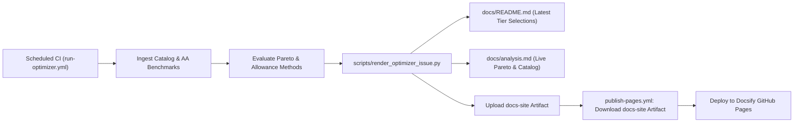

# OpenCode Go Model Optimizer — Latest Tier Selections

This file is populated in CI by `scripts/render_optimizer_issue.py` from paired Pareto and Allowance JSON outputs (`--pareto-json` / `--allowance-json`) during the scheduled optimizer workflow run.

