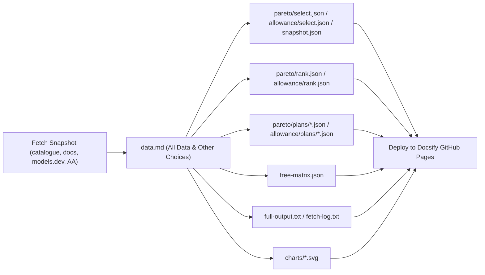

# OpenCode Go Model Optimizer — All Data & Other Choices

This file is populated in CI by `scripts/render_optimizer_issue.py` from paired Pareto and Allowance JSON outputs (`--pareto-json` / `--allowance-json`) during each optimizer run.

